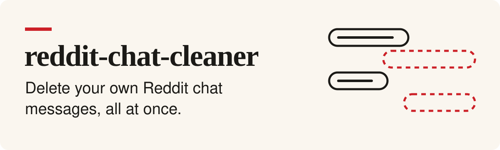
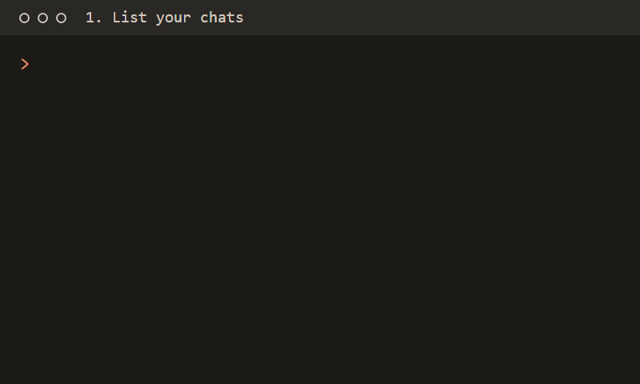

<picture>
  <source media="(prefers-color-scheme: dark)" srcset="assets/banner-dark.svg">
  
</picture>

[](https://github.com/zed-dz/reddit-chat-cleaner/actions/workflows/ci.yml)

**Delete your own Reddit Chat messages in one go, without giving anyone your password.**



The demo is the real script, run on a pretend chat server with sample chats.

## Who it is for

- You have years of Reddit Chat and want your side of it gone.
- Reddit makes you delete messages one at a time.
- You will not hand your account to a website or an app.

## Install

There is nothing to install. It runs in the Reddit tab where you are already logged in.

1. On a computer, open https://www.reddit.com/chat/ and log in.
2. Press **F12** and click **Console**.
3. Open [`reddit_chat_cleaner.js`](reddit_chat_cleaner.js), copy all of it, paste it and press **Enter**.
   Chrome may ask you to type `allow pasting` first.
4. List your chats. This only reads:

```js
await rc.list()
```

> [!WARNING]
> Only paste code you have read. A stranger who asks you to paste code in the console may be trying to take your account. This file is about 220 lines. Read it, or ask someone you trust to read it.

## What it does

See what would go. Nothing is deleted:

```js
await rc.wipe(['name1', 2], { dryRun: true })
```

Use the name in the `who` column or the number in the `n` column. Then delete. It shows the total and asks you first:

```js
await rc.wipe(['name1', 2])
```

Every chat at once:

```js
await rc.wipe('all')
```

| Command | What it does |
|---|---|
| `{ dryRun: true }` | Show, delete nothing. |
| `{ hide: false }` | Delete your messages but keep the chat in your list. |
| `{ yes: true }` | Do not ask before deleting. |
| `rc.stop()` | Stop after the current message. Type it while a run is going. |

It works one message at a time. When Reddit says slow down, it waits as long as Reddit asks.

## Safety and privacy

- **Deleting is permanent.** Nobody can bring the messages back. Do the dry run first.
- **Only your messages.** It never tries to delete the other person's.
- **Two chats with the same name are refused.** Display names can be copied. Pick by number.
- **A chat is hidden only when it is empty of you.** If it could not be read, or one delete failed, it stays in your list.
- **Your token stays with Reddit.** The script reads your chat session from the page, sends it only to `matrix.redditspace.com`, never prints it and saves nothing.
- **It stops** if your session ends or if you switch accounts.

18 tests run against a pretend chat server. No test touches Reddit:

```
git clone https://github.com/zed-dz/reddit-chat-cleaner
cd reddit-chat-cleaner
node --test
```

## How it compares

I read the other project's page on 25 November 2026.

| | reddit-chat-cleaner | By hand on Reddit | [reddit-chat-delete](https://github.com/sir-bingus/reddit-chat-delete) |
|---|---|---|---|
| In bulk | yes | no | yes |
| To set up | nothing, paste one file | nothing | Python 3.9 and an install step |
| Dry run first | yes | no | yes, by default |
| Only your attachments | no | one at a time | yes |
| A list of people to leave alone | no, you pick the chats | you pick | yes |

If you have many chats and want to protect some people by name, reddit-chat-delete does more. If you do not want to install anything, use this one.

## Limits

- Chat only. Not the old Messages inbox, not posts, not comments.
- Computer browsers only.
- The other person may have read, copied or screenshotted your messages.
- "Hide" removes the chat from your list. Reddit has no leave button for one-to-one chats. The chat comes back when someone writes in it.
- Reddit can change its chat at any time and break this. Check Reddit's rules on automated use and decide for yourself.
- The current version passed its tests on a pretend server. If it fails on the real one, [open an issue](https://github.com/zed-dz/reddit-chat-cleaner/issues/new/choose).

## How it works

Reddit Chat runs on [Matrix](https://matrix.org), an open chat protocol. The script uses standard Matrix calls: list your rooms, read the history, redact each of your own messages, and set Reddit's hidden flag on the room.

## Contributing

Read [CONTRIBUTING.md](CONTRIBUTING.md). For a security problem, see [SECURITY.md](SECURITY.md).

## Licence

[MIT](LICENSE). Not made or approved by Reddit. Made by Amine Hammou. More tools: https://aminehammou.vercel.app/tools.html
